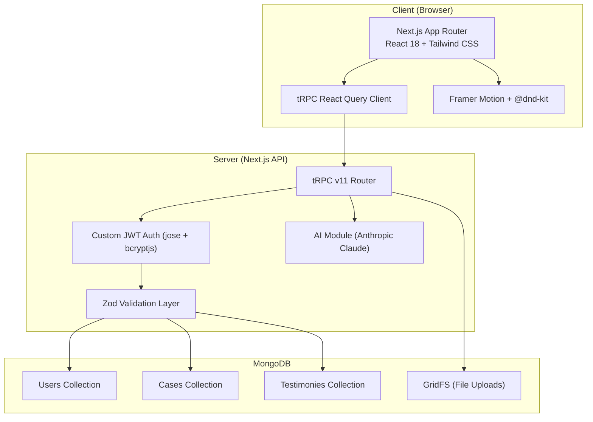

# 🕵️‍♂️ FormFlow — Noir Detective Form Builder SaaS

> **Re-imagine generic forms as sworn Case Files.** Gather answers as **Testimony**, interrogate informants with interactive **Clues**, and analyze findings on your **Evidence Board**.

FormFlow is a full-featured, production-ready Noir Detective–themed Form Builder SaaS engineered with **Next.js 14** (App Router), **TypeScript** (strict mode), **Tailwind CSS**, **tRPC v11**, **Mongoose**, **Zod**, **Framer Motion**, **@dnd-kit**, **Recharts**, and **Anthropic Claude AI**.

---

## 📸 Feature Overview

| Feature | Description |
|---|---|
| **Case Files** | Create, duplicate, search, filter, and manage detective-themed forms |
| **Drag-and-Drop Builder** | 3-pane layout with `@dnd-kit/sortable`, 17 clue types, live preview |
| **Public Interrogation Room** | Public deposition form at `/c/[shareId]` with dynamic Zod validation |
| **Witness Log** | Testimony table with row-click drawer, bulk delete, CSV/JSON export |
| **Evidence Board** | Analytics dashboard with Recharts timeline, per-clue breakdowns |
| **Conditional Logic** | "Only ask if…" engine with 7 operators, live preview hiding |
| **Multi-Page Wizard** | Page breaks, progress bar, per-page validation |
| **Sharing Suite** | Copy link, PNG QR code generator, HTML iframe embed code |
| **Brief the Detective** | AI-powered form generation via Anthropic Claude (with offline fallback) |
| **Detective's Notes** | AI builder suggestions panel for case file improvement |
| **Detective's Verdict** | AI testimony summary card on Evidence Board |
| **Light / Dark Themes** | Midnight Stakeout (dark) & Daytime Office (light) with persistent toggle |

---

## 🗂️ Detective Theme Vocabulary

| Standard Concept | Noir Vocabulary |
|---|---|
| Form | **Case** |
| Field / Question | **Clue** |
| Response / Submission | **Testimony** |
| Analytics Dashboard | **Evidence Board** |
| Public Share Link | **Case Link** |
| Export Data | **Case Report** |
| AI Form Generator | **Brief the Detective** |
| Draft Status | **Open Case** |
| Published Status | **Active** |
| Closed Status | **Cold Case** |

---

## 🏗️ Architecture



### Key Directory Structure

```
src/
├── app/
│   ├── api/
│   │   ├── cases/[id]/export/route.ts   # CSV/JSON Case Report export
│   │   ├── files/[id]/route.ts          # GridFS file download (owner-gated)
│   │   ├── forms/[id]/export/route.ts   # Alternative export endpoint
│   │   ├── trpc/[trpc]/route.ts         # tRPC HTTP handler
│   │   └── upload/route.ts              # GridFS file upload
│   ├── c/[shareId]/page.tsx             # Public Interrogation Room
│   ├── f/[slug]/page.tsx                # Alternative public form route
│   ├── dashboard/
│   │   ├── [id]/
│   │   │   ├── evidence/page.tsx        # Evidence Board Analytics
│   │   │   ├── settings/page.tsx        # Case Settings & Intake Controls
│   │   │   ├── testimonies/page.tsx     # Witness Log
│   │   │   ├── layout.tsx               # Case detail layout
│   │   │   └── page.tsx                 # Case Builder (drag-and-drop)
│   │   └── page.tsx                     # Case Files dashboard
│   ├── login/page.tsx
│   ├── signup/page.tsx
│   ├── error.tsx                        # Custom error boundary
│   ├── not-found.tsx                    # Custom 404 page
│   ├── layout.tsx                       # Root layout
│   ├── globals.css
│   └── page.tsx                         # Landing page + Pricing
├── components/
│   ├── AIGeneratorModal.tsx             # "Brief the Detective" modal
│   ├── ClueInspector.tsx                # Right-pane clue property editor
│   ├── ClueRenderer.tsx                 # 17-type clue renderer
│   ├── DetectiveNotesPanel.tsx          # AI suggestions panel
│   ├── DetectiveVerdictCard.tsx         # AI testimony summary
│   ├── EvidenceBoardCharts.tsx          # Recharts analytics components
│   ├── EvidenceLocker.tsx               # File upload component
│   ├── Navbar.tsx                       # Top navigation bar
│   ├── ShareModal.tsx                   # Link, QR, embed sharing modal
│   ├── SortableClueItem.tsx             # Drag-and-drop clue item
│   └── ui/                             # Shared UI primitives
│       ├── Badge.tsx, Button.tsx, Card.tsx
│       ├── EmptyState.tsx, Input.tsx, Modal.tsx
│       ├── Select.tsx, Spinner.tsx, Stamp.tsx
│       ├── Textarea.tsx, ThemeToggle.tsx, Toast.tsx
├── lib/
│   ├── auth.ts                          # JWT sign/verify, bcrypt helpers
│   ├── db.ts                            # Mongoose singleton connection
│   ├── env.ts                           # Zod environment variable validation
│   ├── gridfs.ts                        # GridFS bucket helpers
│   ├── schemas.ts                       # All Zod schemas & TypeScript types
│   ├── trpc/
│   │   ├── client.ts                    # tRPC client setup
│   │   └── Provider.tsx                 # React Query + tRPC provider
│   └── validation.ts                    # evaluateCondition, buildResponseSchema
├── server/
│   ├── ai.ts                            # Anthropic API client + offline fallback
│   ├── models/
│   │   ├── Case.ts                      # Mongoose Case model
│   │   ├── Testimony.ts                 # Mongoose Testimony model
│   │   └── User.ts                      # Mongoose User model
│   ├── routers/
│   │   ├── _app.ts                      # Merged tRPC app router
│   │   ├── ai.ts                        # AI router (20 calls/day limit)
│   │   ├── auth.ts                      # Auth router (register, login, logout, me)
│   │   ├── case.ts                      # Case CRUD router (owner-gated)
│   │   └── testimony.ts                 # Testimony router
│   └── trpc.ts                          # tRPC context & middleware
├── scripts/
│   └── seed.ts                          # Database seed script
├── __tests__/
│   └── run-tests.ts                     # Unit test suite (8 tests)
└── middleware.ts                         # Next.js middleware (auth route protection)
```

---

## 🚀 Quick Start

### Prerequisites

- **Node.js** ≥ 18
- **npm** ≥ 9
- **MongoDB** (local `mongod` or [MongoDB Atlas](https://www.mongodb.com/atlas))

### 1. Clone & Install

```bash
git clone <your-repo-url> formflow
cd formflow
npm install
```

### 2. Configure Environment Variables

Create a `.env.local` file in the project root:

```env
# Required
MONGODB_URI=mongodb://127.0.0.1:27017/formflow
JWT_SECRET=your_secure_secret_key_minimum_16_chars

# Optional
ANTHROPIC_API_KEY=sk-ant-...           # For AI features
RESEND_API_KEY=re_...                  # For email notifications
NEXT_PUBLIC_APP_URL=http://localhost:3000
```

### 3. Seed Demo Data (Optional)

```bash
npm run seed
```

This creates:
- **Detective user**: `detective@noir.com` / `password123`
- **Sample Case**: "The Maltese Falcon Heist" with 5 sworn testimonies

### 4. Run Development Server

```bash
npm run dev
```

Open [http://localhost:3000](http://localhost:3000) in your browser.

### 5. Type Check & Build

```bash
npm run typecheck    # tsc --noEmit
npm run build        # Next.js production build
```

---

## 📜 Available Scripts

| Script | Command | Description |
|---|---|---|
| `dev` | `npm run dev` | Start Next.js dev server |
| `build` | `npm run build` | Production build |
| `start` | `npm start` | Start production server |
| `lint` | `npm run lint` | Run ESLint |
| `typecheck` | `npm run typecheck` | Run `tsc --noEmit` |
| `seed` | `npm run seed` | Seed database with demo detective + case |
| `test` | `npm run test` | Run unit test suite |

---

## 🎨 Design System

### Color Palette

| Token | Hex | Usage |
|---|---|---|
| Ink Black | `#0b0b0d` | Primary background |
| Desk Dark | `#15151a` | Card/panel backgrounds |
| Aged Paper | `#e9dfc7` | Primary text, paper texture |
| Paper Dark | `#cfc3a3` | Secondary text, borders |
| Lamp Amber | `#f0b44c` | Primary accent, CTAs |
| String Red | `#b3261e` | Danger, delete, alerts |
| Fog Grey | `#8a8a92` | Muted/secondary text |

### Typography

| Font | CSS Class | Usage |
|---|---|---|
| **Playfair Display** | `font-serif` | Headings, title stamps |
| **Special Elite** | `font-typewriter` | Typewriter stamps, timestamps |
| **Inter** | `font-sans` | Body copy, form inputs |

### Themes

- **Midnight Stakeout** — Dark mode (default)
- **Daytime Office** — Light mode
- Persistent toggle via `ThemeToggle` component (localStorage backed)

---

## 🔒 Security

| Feature | Implementation |
|---|---|
| **Authentication** | Custom JWT in `httpOnly` cookie (`auth_token`), `jose` + `bcryptjs` |
| **Owner Guards** | All tRPC procedures & API routes enforce `userId === ctx.user.userId` |
| **Anti-Bot** | Honeypot field (`bureau_code`) on public submission forms |
| **Rate Limiting** | IP-based rate limiting on public submissions; 20 AI calls/day per user |
| **CSV Injection Defense** | Cells starting with `=`, `+`, `-`, `@` prefixed with `'` |
| **File Upload** | GridFS with owner-restricted download endpoint |
| **Security Headers** | HSTS, X-Frame-Options, X-Content-Type-Options, Referrer-Policy, Permissions-Policy |
| **Environment Validation** | Zod schema validation for all env vars at startup |

---

## 🌐 Deployment (Vercel + MongoDB Atlas)

### Vercel

1. Push your repo to GitHub / GitLab
2. Import the project on [vercel.com](https://vercel.com)
3. Add environment variables in Vercel dashboard:
   - `MONGODB_URI` — your Atlas connection string
   - `JWT_SECRET` — strong 32+ character secret
   - `ANTHROPIC_API_KEY` — (optional) for AI features
4. Deploy — Vercel auto-detects Next.js

### MongoDB Atlas

1. Create a free M0 cluster at [cloud.mongodb.com](https://cloud.mongodb.com)
2. Create a database user with read/write access
3. Add `0.0.0.0/0` to Network Access (or Vercel's IP range)
4. Copy the connection string to `MONGODB_URI`

---

## 🧪 Testing

### Unit Tests

```bash
npm run test
```

**Test Suites:**
1. **Conditional Logic Engine** — `evaluateCondition` with `equals`, `contains`, `greater_than`, `is_empty` operators
2. **Dynamic Response Schema** — `buildResponseSchema` validates correct payloads and rejects invalid emails
3. **CSV Formula Injection Defense** — `sanitizeCsvCell` prefixes `=`, `+`, `-`, `@` triggers

**Result:** 8/8 tests passing ✅

---

## 💡 V2 Roadmap Ideas

| Feature | Description |
|---|---|
| **Team Workspaces** | Multi-detective bureau with role-based access (Detective, Sergeant, Chief) |
| **Webhooks** | Fire HTTP webhooks on new testimony submission |
| **Email Notifications** | Resend integration for real-time testimony alerts |
| **Form Templates** | Pre-built case file templates (Event RSVP, Feedback Survey, Incident Report) |
| **Payment Clue** | Stripe-powered payment field for premium interrogation forms |
| **Custom Domains** | Vanity URLs for public interrogation rooms |
| **Localization** | i18n support for multi-language case files |
| **Audit Trail** | Complete edit history with diff viewer per case file |
| **API Access** | Public REST/GraphQL API for programmatic case management |
| **Real-time Collaboration** | Live multi-cursor editing via Yjs/CRDT |

---

## 📄 License

MIT License. See [LICENSE](LICENSE) for details.

---

<p align="center">
  <em>"Every case tells a story. Every clue leads somewhere."</em><br/>
  <strong>— FormFlow Bureau of Investigation</strong>
</p>
